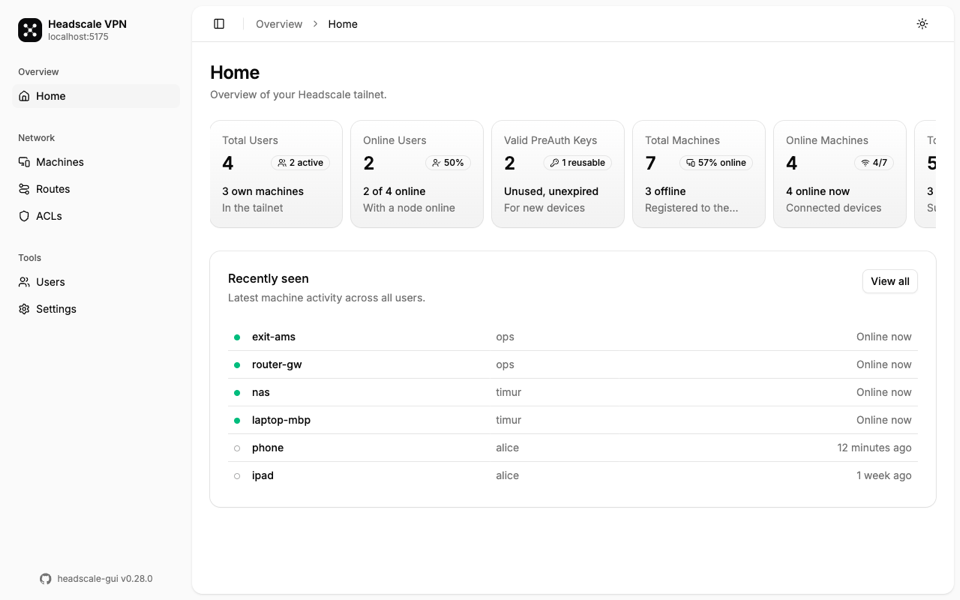
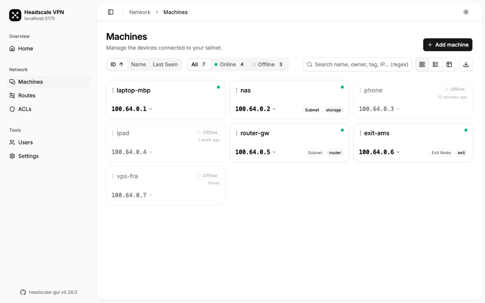

# headscale-gui (Headscale VPN)

A clean web UI for [juanfont/headscale](https://github.com/juanfont/headscale), the self-hosted Tailscale control server. Fork of [GoodiesHQ/headscale-admin](https://github.com/GoodiesHQ/headscale-admin) (v0.28, Headscale 0.28 API), rebuilt with [shadcn-svelte](https://www.shadcn-svelte.com) and a Tailscale-like admin experience.

<p>
  
  
</p>

**Features:** machines as tiles / list / table with sort, online filter and search (name, owner, tag, IP) · per-machine page (`/admin/nodes/<ip>/`) with keys, addresses, routes, tags, expiry, delete · *Add machine* dialog (download links, `--login-server` command, key registration, advanced `tailscale up` builder with pre-auth keys) · users and pre-auth keys · route approval · ACL builder (groups, tag owners, hosts, policies, SSH, auto approvers, raw config) · CSV export · light/dark · remembers your last page, filters and tabs.

The UI is a static single-page app. It holds no secrets: your Headscale API key is stored only in your browser and sent straight to the Headscale API.

## Run it next to Headscale

Serve the UI **on the same domain as Headscale, under `/admin`**. Then the browser talks to the Headscale API on the same origin and no CORS setup is needed. Headscale itself doesn't serve web files, so a reverse proxy (Caddy, nginx, Traefik…) routes `/admin` to the UI and everything else to Headscale.

### Option A — Docker image

```yaml
# docker-compose.yml (full example: example/)
services:
  headscale:
    image: headscale/headscale:0.28
    command: serve
    volumes: [./headscale-conf:/etc/headscale, ./headscale-data:/var/lib/headscale]
  headscale-gui:
    image: ghcr.io/tjunussov/headscale-gui:latest   # serves /admin on :80
  caddy:
    image: caddy:latest
    ports: ["80:80", "443:443"]
    volumes: [./Caddyfile:/etc/caddy/Caddyfile, ./caddy-data:/data]
```

```caddyfile
headscale.example.com {
    reverse_proxy /admin* headscale-gui:80
    reverse_proxy headscale:8080
}
```

Tags: `latest` (main) and `X.Y.Z` / `X.Y` for releases. The image is built for `ENDPOINT=/admin`. For another path, build it yourself: `docker build --build-arg ENDPOINT=/manager -t headscale-gui .`

### Option B — static files (no extra container)

Ready-built files, no Node needed. Either track the auto-built [`static` branch](https://github.com/tjunussov/headscale-gui/tree/static) (always the latest `main`):

```bash
git clone -b static --depth 1 https://github.com/tjunussov/headscale-gui /srv/headscale-gui   # update: git -C /srv/headscale-gui pull
```

or download `headscale-gui-admin.zip` from the [latest release](https://github.com/tjunussov/headscale-gui/releases/latest) and unzip it:

```bash
sudo mkdir -p /srv/headscale-gui && sudo unzip headscale-gui-admin.zip -d /srv/headscale-gui
```

Both give you `/srv/headscale-gui/admin/`.

Unknown paths under `/admin` (e.g. machine pages) must fall back to `admin/200.html`:

**Caddy**
```caddyfile
headscale.example.com {
    handle /admin* {
        root * /srv/headscale-gui
        try_files {path} {path}.html {path}/index.html /admin/200.html
        file_server
    }
    reverse_proxy localhost:8080
}
```

**nginx**
```nginx
location /admin/ {
    root /srv/headscale-gui;
    try_files $uri $uri.html $uri/index.html /admin/200.html;
}
location / {
    proxy_pass http://127.0.0.1:8080;
    proxy_http_version 1.1;
    proxy_set_header Upgrade $http_upgrade;
    proxy_set_header Connection $connection_upgrade;   # map $http_upgrade $connection_upgrade { default upgrade; '' close; }
    proxy_set_header Host $host;
    proxy_set_header X-Forwarded-For $proxy_add_x_forwarded_for;
    proxy_set_header X-Forwarded-Proto $scheme;
    proxy_buffering off;
}
```

### Option C — build it yourself

```bash
git clone https://github.com/tjunussov/headscale-gui && cd headscale-gui
npm ci
ENDPOINT=/admin npm run build     # → ./build ; ENDPOINT= (empty) serves from the domain root
```

Copy `./build` to `<web root>/admin` and use the same fallback rule as in option B.

### First login

1. Create an API key on the server: `headscale apikeys create --expiration 90d`
   (Docker: `docker exec headscale headscale apikeys create --expiration 90d`)
2. Open `https://headscale.example.com/admin/` → **Settings**. Leave *API URL* empty when the UI runs on the Headscale domain, paste the key, **Save Settings**.

Hosting the UI on a different domain also works. Then Headscale (or its proxy) must allow that origin via CORS; see `example/Caddyfile`.

## Development

```bash
npm install
npm run dev:mock      # UI + in-memory mock Headscale (no server needed) → http://localhost:5173
                      # Settings: empty API URL, any key (e.g. mock-key)
HEADSCALE=http://host:8080 npm run dev   # UI against a real server (Vite proxies /api, no CORS)
npm run test:mock     # mock self-test
npx svelte-check --tsconfig ./tsconfig.json && npm run build
```

Mock knobs: `MOCK_DELAY=600` (slow responses), `MOCK_FLAP=1` (machines go on/offline). Project conventions and layout for contributors and AI agents: [AGENTS.md](AGENTS.md).

## Credits & license

Based on [GoodiesHQ/headscale-admin](https://github.com/GoodiesHQ/headscale-admin) by GoodiesHQ; upstream fixes are ported from its release tags. Licensed under **GPL-3.0** (see [LICENSE](LICENSE)), same as upstream.
